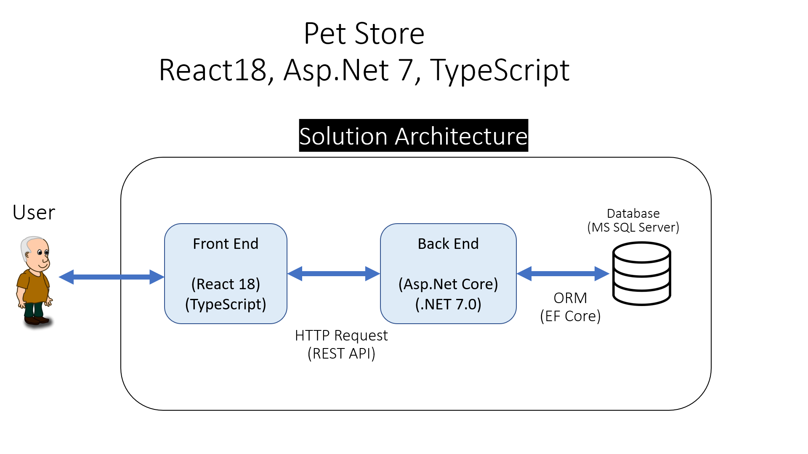

# Pet Store

## YouTube Tutorial
https://www.youtube.com/watch?v=5N9FsYPsAso

## Solution Technologies

-  Asp.Net Core (.NET 7.0)
-  React 18
-  TypeScript
-  MS SQL SERVER
-  Entity Framework Core

## Solution Architecture



## We will learn these topics together

### On Backend project

-  Entities
-  Dtos
-  Context
-  ORM
-  Http Methods
-  Swagger
-  Postman
-  Postman Collections

### On Frontend project

-  Sending state while redirecting user
-  Nested Routing
-  useState
-  useEffect
-  Sweet Alert on Create, Edit and Delete
-  Confirmation on Delete
-  Elegant, Beatifull and fully Responsive Navbar
-  TypeScript Interface
-  TypeScript Partial
-  Axios
-  SASS
-  Mixin
-  Moment

## Product images

Product images are uploaded through the API and stored under `backend/backend/wwwroot/uploads`. The database stores the relative image URL in `Products.ImageUrl`. Uploads accept JPG, PNG, and WebP images up to 5 MB. Apply pending database migrations from the `backend` directory with:

```sh
dotnet ef database update --project backend/backend.csproj
```

## Demo product sources

The five seeded demo products use descriptions paraphrased from the manufacturer pages below. Their product photos were downloaded from the corresponding official KONG product pages and are stored locally in `backend/backend/wwwroot/uploads`.

- [KONG Classic](https://www.kongcompany.com/kong-classic/)
- [KONG Extreme](https://www.kongcompany.com/kong-extreme/)
- [KONG Wobbler](https://www.kongcompany.com/wobbler/)
- [KONG Naturals Scratcher Double](https://www.kongcompany.com/naturals-scratcher-double/)
- [KONG ZoomGroom Boysenberry](https://www.kongcompany.com/zoomgroom-boysenberry/)

## Local configuration

- Copy `frontend/.env.example` to `frontend/.env.local` and set `REACT_APP_API_BASE_URL` if your API uses a different address. Create React App loads this file automatically.
- For the backend, configure `ConnectionStrings__local` using an environment variable or .NET User Secrets. To use User Secrets, run `dotnet user-secrets init --project backend/backend/backend.csproj`, then `dotnet user-secrets set "ConnectionStrings:local" "<your connection string>" --project backend/backend/backend.csproj`.
- `backend/backend/.env.example` documents the equivalent environment-variable setting; ASP.NET Core does not load `.env` files by itself.
- Never commit real `.env` files, passwords, or Azure connection strings. The repository `.gitignore` excludes them and preserves the `.env.example` templates.
